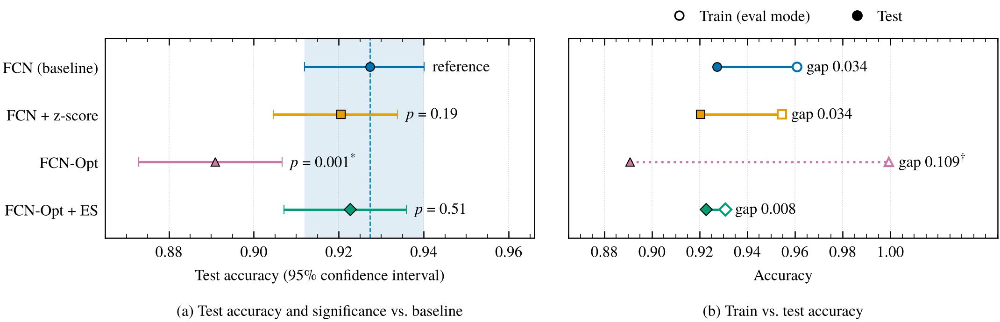
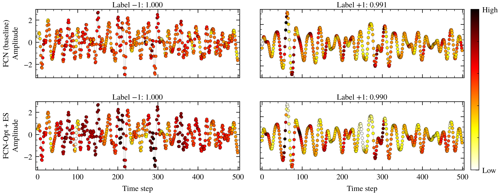

# Reimplementing a Fully Convolutional Network for Time Series Classification

COMP41850 AI for Time Series, University College Dublin. Group time_machine: Jia Yi Leong, Zhuoxun Xu, Yijie Zhu.

Univariate time series classification assigns a label to an ordered sequence of measurements. Wang et al. [[1]](https://arxiv.org/abs/1611.06455) proposed three end-to-end deep baselines (MLP, FCN and ResNet) and released Keras code with results on 85 UCR datasets [[2]](https://github.com/cauchyturing/UCR_Time_Series_Classification_Deep_Learning_Baseline). The FCN needs no handcrafted features, and its global average pooling layer gives class activation maps (CAM) that show which parts of a series drive a prediction.

This repository reimplements the FCN in PyTorch and studies it on the UCR FordA dataset [[3]](https://www.cs.ucr.edu/~eamonn/time_series_data_2018/). We checked the supplied normalization, tuned the network with Optuna [[5]](https://arxiv.org/abs/1907.10902), trained a shorter early-stopped version, and analysed the CAMs with a controlled deletion test. FordB and Adiac were then added as a generalization check, and a supplementary run applies the FordA settings to 40 two-class UCR datasets.

## Summary

- On FordA, the PyTorch baseline reached 92.73% test accuracy, compared with 90.6% in the authors' published results. Batch size, learning-rate schedule and checkpoint selection differ from the original code, so this difference cannot be attributed to the framework.
- An Optuna-tuned FCN stopped by validation accuracy (FCN-Opt + ES) reached 92.27% after 11 epochs. An exact McNemar test did not detect a difference from the baseline (p = 0.51), which does not show that the two are equivalent.
- On FordB and Adiac, the same procedure, with a new search on each dataset, gave a lower mean test error than the baseline with far fewer epochs. The difference was not significant on FordB (one seed); on Adiac it was significant for two of three seeds, and on the third the baseline was slightly better. Both of our models remain above the authors' FCN error on these two datasets.
- Removing the time steps with the highest CAM scores reduced FordA accuracy more than removing the same number of steps at shifted positions.
- All results come from single training runs unless stated otherwise (Adiac uses three seeds).

## Network Structure

Each FCN block is a 1-D convolution (stride 1, same padding), batch normalization and ReLU. Three blocks are followed by global average pooling and a linear layer that outputs the class logits for cross-entropy loss.

| | Filters | Kernel sizes | Trainable parameters (two classes) |
|---|---|---|---|
| FCN, as in the paper ([`FCN_model/FCN.py`](FCN_model/FCN.py)) | 128 / 256 / 128 | 8 / 5 / 3 | 264,962 |
| FCN-Opt, Optuna on FordA ([`FCN_model/FCN_tune.py`](FCN_model/FCN_tune.py)) | 256 / 128 / 64 | 8 / 10 / 6 | 380,354 |

`FCN_tune` takes the filters and kernel sizes as arguments, so the per-dataset searches in `multi_dataset/` reuse it with other settings. BatchNorm uses epsilon 0.001 and PyTorch momentum 0.01, the PyTorch equivalent of the Keras defaults.

## Repository Structure

| Path | Contents |
|---|---|
| `FCN_model/` | PyTorch FCN (`FCN.py`) and the configurable version used for tuning (`FCN_tune.py`) |
| `FCN.py` | The authors' original Keras code, run with TensorFlow 2 in `UCR-tensorflow` |
| `FCN_training.ipynb` | FordA training: baseline, extra z-score, full-budget FCN-Opt, FCN-Opt + ES, test evaluation; the last section runs FCN-Opt + ES on many UCR datasets |
| `Hyperparam_tuning_FCN.ipynb` | Optuna search on FordA; results in `optuna_metrics.csv` and `fcn_optuna.db` |
| `FCN_*metrics*.csv` | Per-epoch training logs of the four FordA models |
| `*.pth`, `earlystop/` | Saved FordA checkpoints |
| `preprocessing/` | Data exploration: sample plots, distributions, first-order differences, ACF/PACF, class DTW distances (FordA, FordB), Adiac normalization |
| `FordA/`, `FordB/`, `Adiac/` | UCR data as supplied; `*_processed/` hold the exported and differenced arrays |
| `report_figures/` | Scripts that build the report figures and tables (`make_figures.py`, `infer.py`) and their output in `figures/` |
| [`multi_dataset/`](multi_dataset/README.md) | FordA / FordB / Adiac comparison: training, per-dataset Optuna search, 1-NN DTW and McNemar scripts, and every run's results |
| `all_data/`, `all_data_metrics/` | Supplementary run on 40 two-class UCR datasets: checkpoints and per-epoch logs |
| `UCR-pytorch.yml`, `UCR-tensorflow.yml` | Conda environments |

## Getting Started

Install [Miniconda](https://docs.anaconda.com/miniconda/), then create the environment you need from the repository root:

```bash
conda env create -f UCR-pytorch.yml      # PyTorch notebooks (Windows, CUDA)
conda env create -f UCR-tensorflow.yml   # preprocessing notebooks and the original Keras FCN.py
conda env create -f multi_dataset/environment-mac.yml   # multi_dataset scripts (macOS, Apple MPS)
```

The FordA notebooks were run on Windows with an NVIDIA GPU. Everything in `multi_dataset/runs/` was produced on an Apple M5 (PyTorch MPS); see [`multi_dataset/README.md`](multi_dataset/README.md) for its environment and commands. Results can differ slightly between CUDA and MPS even with the same seed.

FordA, FordB and Adiac are included in the repository. The supplementary run needs the full UCR 2018 archive [[3]](https://www.cs.ucr.edu/~eamonn/time_series_data_2018/) unpacked as `UCRArchive_2018/` in the repository root; this folder is not tracked by git.

## Classification Results

All tables report **test** error (1 − accuracy) on the supplied UCR train/test split. Test data were not used for model selection.

### FordA

| Model | Test error | Accuracy | 95% Wilson CI | Macro F1 | AUC | Checkpoint (epoch) |
|---|---|---|---|---|---|---|
| FCN (baseline) | 0.0727 | 0.9273 | [0.912, 0.940] | 0.9273 | 0.9787 | lowest training loss (1,906) |
| FCN + z-score | 0.0795 | 0.9205 | [0.905, 0.934] | 0.9205 | 0.9769 | lowest training loss (1,899) |
| FCN-Opt | 0.1091 | 0.8909 | [0.873, 0.907] | 0.8896 | / | epoch 408 (weights not available) |
| FCN-Opt + ES | 0.0773 | 0.9227 | [0.907, 0.936] | 0.9227 | 0.9781 | lowest validation loss (11) |
| *Reference:* authors' FCN [[2]](https://github.com/cauchyturing/UCR_Time_Series_Classification_Deep_Learning_Baseline) | 0.094 | 0.906 | | | | |
| *Reference:* 1-NN DTW, window 0.01 | 0.3091 | 0.6909 | | | | |

The baseline used Adam (learning rate 0.001), batch size 360 and 2,000 epochs on all 3,601 training series. FCN + z-score applied an extra global z-score to data that were already normalized. FCN-Opt retrained the Optuna settings (AdamW, learning rate 0.00404, batch size 64) for 2,000 epochs. FCN-Opt + ES used a stratified 90/10 split and stopped once validation accuracy reached 0.93. Exact McNemar tests against the baseline: FCN + z-score p = 0.188, FCN-Opt + ES p = 0.512.



### FordB and Adiac

| Dataset | FCN (authors) | 1-NN DTW, window 0.01 | FCN (baseline) | FCN-Opt + ES | McNemar p | Selected epoch (baseline / Opt + ES) |
|---|---|---|---|---|---|---|
| FordA | 0.094 | 0.309 | 0.073 | 0.077 | 0.51 | 1,906 / 11 |
| FordB | 0.117 | 0.393 | 0.207 | 0.188 | 0.16 | 1,966 / 20 |
| Adiac | 0.143 | 0.358 | 0.260 ± 0.087 | 0.173 ± 0.020 | 0.66 / <0.001 / 0.002 | 1,953–1,995 / 691–1,030 |

FordB has 3,636 training and 810 test series (two classes); Adiac has 390 and 391 (37 classes). For FCN-Opt + ES, the Optuna search was repeated on each dataset's training data with the FordA search space, and training stopped on validation-loss patience, because the 0.93 accuracy threshold was specific to FordA. Adiac values are the mean ± standard deviation over seeds 42, 43 and 44, with one McNemar test per seed. The hyperparameters, validation split and stopping rule all change together, so the gain cannot be attributed to one of them, and fewer epochs did not mean shorter training on Adiac. Full protocol, per-run results and commands: [`multi_dataset/README.md`](multi_dataset/README.md).

### Supplementary: FCN-Opt + ES on 40 two-class UCR datasets

This run applies the FordA FCN-Opt + ES settings unchanged to 42 two-class datasets of the UCR 2018 archive, without tuning per dataset: FCN 256/128/64 with kernels 8/10/6, AdamW (learning rate 0.00404, no weight decay), batch size 32, shuffled training batches, stratified 90/10 split (random state 42), at most 2,000 epochs, stopping when validation accuracy reaches 0.93, and the checkpoint with the lowest validation loss. DodgerLoopGame and DodgerLoopWeekend saved no checkpoint and have no test result. The code is the last section of `FCN_training.ipynb`; checkpoints are in `all_data/` and per-epoch logs in `all_data_metrics/`. The test errors below were taken from that notebook's saved output. The authors' columns are copied from their README [[2]](https://github.com/cauchyturing/UCR_Time_Series_Classification_Deep_Learning_Baseline), which used the earlier 85-dataset archive; "/" means the dataset is not in their table.

| Dataset | FCN (authors) | 1NN-DTW (authors) | FCN-Opt + ES (ours) | Checkpoint epoch / epochs run |
|---|---|---|---|---|
| BeetleFly | 0.050 | 0.300 | 0.250 | 6 / 6 |
| BirdChicken | 0.050 | 0.250 | 0.050 | 908 / 908 |
| Chinatown | / | / | 0.682 | 43 / 43 |
| Coffee | 0 | 0 | 0.321 | 319 / 319 |
| Computers | 0.152 | 0.300 | 0.212 | 137 / 145 |
| DistalPhalanxOutlineCorrect | 0.188 | 0.232 | 0.217 | 87 / 125 |
| Earthquakes | 0.199 | 0.258 | 0.252 | 21 / 2000 |
| ECG200 | 0.100 | 0.230 | 0.150 | 39 / 39 |
| ECGFiveDays | 0.015 | 0.232 | 0.512 | 7 / 7 |
| FordA | 0.094 | 0.438 | 0.067 | 14 / 14 |
| FordB | 0.117 | 0.406 | 0.207 | 25 / 25 |
| FreezerRegularTrain | / | / | 0.053 | 79 / 79 |
| FreezerSmallTrain | / | / | 0.406 | 515 / 515 |
| GunPoint | 0 | 0.093 | 0.360 | 29 / 29 |
| GunPointAgeSpan | / | / | 0.038 | 250 / 313 |
| GunPointMaleVersusFemale | / | / | 0.057 | 51 / 51 |
| GunPointOldVersusYoung | / | / | 0.016 | 51 / 51 |
| Ham | 0.238 | 0.533 | 0.333 | 93 / 110 |
| HandOutlines | 0.224 | 0.202 | 0.157 | 1295 / 1295 |
| Herring | 0.297 | 0.469 | 0.344 | 135 / 2000 |
| HouseTwenty | / | / | 0.151 | 22 / 22 |
| ItalyPowerDemand | 0.03 | 0.050 | 0.142 | 55 / 55 |
| Lightning2 | 0.197 | 0.131 | 0.328 | 46 / 46 |
| MiddlePhalanxOutlineCorrect | 0.205 | 0.352 | 0.168 | 103 / 177 |
| MoteStrain | 0.05 | 0.165 | 0.272 | 3 / 3 |
| PhalangesOutlinesCorrect | 0.174 | 0.272 | 0.184 | 105 / 2000 |
| PowerCons | / | / | 0.233 | 29 / 29 |
| ProximalPhalanxOutlineCorrect | 0.100 | 0.216 | 0.161 | 31 / 34 |
| SemgHandGenderCh2 | / | / | 0.165 | 115 / 116 |
| ShapeletSim | 0.133 | 0.350 | 0.256 | 168 / 168 |
| SonyAIBORobotSurface1 | 0.032 | 0.275 | 0.030 | 28 / 28 |
| SonyAIBORobotSurface2 | 0.038 | 0.169 | 0.100 | 2 / 2 |
| Strawberry | 0.031 | 0.060 | 0.097 | 23 / 23 |
| ToeSegmentation1 | 0.031 | 0.228 | 0.070 | 41 / 42 |
| ToeSegmentation2 | 0.085 | 0.162 | 0.377 | 324 / 324 |
| TwoLeadECG | 0 | 0.096 | 0.124 | 23 / 23 |
| Wafer | 0.003 | 0.020 | 0.031 | 9 / 9 |
| Wine | 0.111 | 0.426 | 0.167 | 1477 / 1477 |
| WormsTwoClass | 0.271 | 0.337 | 0.338 | 927 / 928 |
| Yoga | 0.155 | 0.164 | 0.178 | 560 / 2000 |

Notes on this run:

- It is a single run per dataset with settings tuned on FordA, so it shows how well those settings transfer, not the best FCN result on each dataset. The error was lower than the authors' FCN on 4 of the 31 datasets that appear in both tables, equal on 1 and higher on 26.
- The 0.93 threshold was chosen for FordA. Many of these datasets are small, so the 10% validation split holds only a few series (BeetleFly: 2 of 20). Validation accuracy then reached the threshold within a few epochs on several datasets (MoteStrain 3, SonyAIBORobotSurface2 2, ECGFiveDays 7), and some selected models are weak (ECGFiveDays 0.512, Chinatown 0.682).
- Earthquakes, Herring, PhalangesOutlinesCorrect and Yoga never reached the threshold and trained for all 2,000 epochs. On Earthquakes the selected model predicts only the majority class (macro F1 0.428).
- The FordA result here (0.067) differs from FCN-Opt + ES in the FordA table (0.077): this run used batch size 32 instead of 64 and shuffled training batches, and it is a separate training run.

## Class Activation Maps

For a predicted class *c*, the CAM is the weighted sum of the last convolutional feature maps, using the weights of the linear layer for class *c* [[4]](https://arxiv.org/abs/1512.04150). We measured how much of each test series' positive CAM evidence falls in its top 10% of time steps, and ran a deletion test: the highest-scoring 5–50% of time steps were set to zero, and the same masks shifted to other positions served as controls. On FordA, targeted deletion lowered accuracy more than the shifted controls. This shows that the highlighted positions matter to the model's predictions; it does not identify physical causes in the engine signal.



## References

[1] Z. Wang, W. Yan and T. Oates, "Time series classification from scratch with deep neural networks: A strong baseline," *IJCNN*, 2017. [arXiv:1611.06455](https://arxiv.org/abs/1611.06455)

[2] Z. Wang, UCR Time Series Classification Deep Learning Baseline (code and results). [GitHub](https://github.com/cauchyturing/UCR_Time_Series_Classification_Deep_Learning_Baseline)

[3] H. A. Dau et al., "The UCR time series archive," *IEEE/CAA Journal of Automatica Sinica*, 2019. [Archive page](https://www.cs.ucr.edu/~eamonn/time_series_data_2018/)

[4] B. Zhou, A. Khosla, A. Lapedriza, A. Oliva and A. Torralba, "Learning deep features for discriminative localization," *CVPR*, 2016. [arXiv:1512.04150](https://arxiv.org/abs/1512.04150)

[5] T. Akiba, S. Sano, T. Yanase, T. Ohta and M. Koyama, "Optuna: A next-generation hyperparameter optimization framework," *KDD*, 2019. [arXiv:1907.10902](https://arxiv.org/abs/1907.10902)
